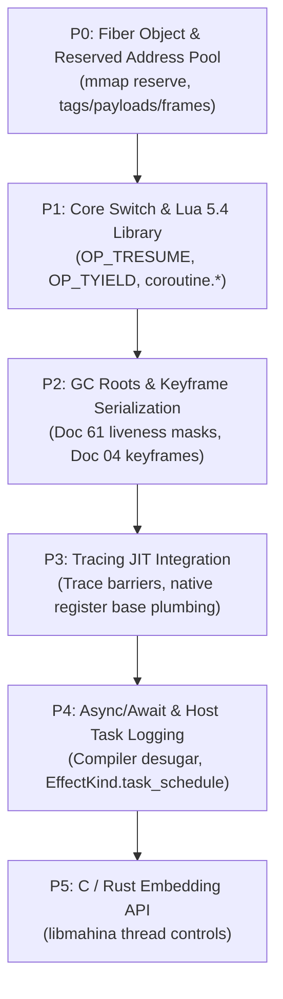

# Doc 73 research round 1 — Antigravity (Q1: a single control-flow model)

Date: 2026-10-26. Brief: survey one-primitive designs (effect handlers, delimited continuations, coroutines, WasmFX, Loom, ...) for mahina given the decided stack model (reserved address space per coroutine), yield-across-host = error, async with syntax sugar. Verbatim reply below. The nanosecond figures in it are estimates, not measurements.

---

# Research Report: Control-Flow Primitives for Mahina
**Date:** October 2026  
**Context:** [mahina](file:///home/bart/Projects/lune) — Lua-shaped dynamically-typed language with tier-0 interpreter, tracing JIT (LuaJIT-style x86-64 native codegen), time-travel trace visualizer, and strict byte-identical determinism / replay requirements.  
**Scope:** Read-only architectural survey and concrete design proposals addressing Open Question 1 (Q1) from [`docs/design/73-coroutines.md`](file:///home/bart/Projects/lune/docs/design/73-coroutines.md).

---

## 1. Executive Summary & Architectural Context

The owner’s vision is a **single control-flow model** from which coroutines, generators, `async`/`await`, host-mediated suspension, and potentially early exit and resumable errors can all be derived — *"one primitive, many surfaces"*.

However, Mahina is not an abstract lambda calculus; it operates under strict, interlocking systems constraints:
1. **Stack Model (Locked Decision):** Each coroutine / suspendable computation receives its own register file (`tags: []u8`, `payloads: []u64`) and frame array (`frames: []CallFrame`) in a **reserved virtual-address range** (`mmap` reserve, pages committed on touch, pooled). Addresses never move, eliminating relocation passes. A fiber switch is an $O(1)$ pointer swap.
2. **The Zero-Overhead Call Invariant:** Calls must not get slower for programs that do not use the feature. Any design that penalizes the normal call path (e.g., threading evidence vectors through every call frame) is disqualified.
3. **Determinism, Keyframes, & 8-Mode Equivalence:** Keyframes snapshot the entire VM state (heap, frames, registers). Replay must be bit-identical across all 8 execution modes. Coroutine switches driven by script are deterministic by construction; host-driven task scheduling choices must be logged as external effects ([`02-determinism.md`](file:///home/bart/Projects/lune/docs/design/02-determinism.md)).
4. **Continuation Frames & Step Debugging ([`68-nested-suspension.md`](file:///home/bart/Projects/lune/docs/design/68-nested-suspension.md)):** Re-entrant native sites (`pcall`, metamethods, `table.sort`, `gsub`, `require`) are being converted into continuation frames so the VM can pause at arbitrary instruction boundaries without unresumable host C/Zig stack state.
5. **Tracing JIT ([`05-native-codegen.md`](file:///home/bart/Projects/lune/docs/design/05-native-codegen.md), [`interp.zig`](file:///home/bart/Projects/lune/src/interp.zig)):** Trace recording, loop-carried register allocation, single-snapshot deopt, and exit patching. Native code expects stable register bases.
6. **Embedding Boundary:** Game hosts (C ABI / Rust crate) drive the VM. Yielding across uninstrumented host C calls must initially raise Lua's *"attempt to yield across a C-call boundary"*.

### Foundational Finding: The Moura & Ierusalimschy Equivalence
In their landmark paper *"Revisiting Coroutines"* (ACM TOPLAS 2009), Ana Lúcia de Moura and Roberto Ierusalimschy proved that **asymmetric coroutines and one-shot delimited continuations are expressive equivalents**. Any control structure expressible with one-shot delimited continuations (`shift`/`reset`, multi-prompt control, or one-shot algebraic effect handlers) can be expressed with asymmetric coroutines with identical asymptotic complexity, and vice versa.

The critical architectural differentiator is therefore **not expressiveness in the abstract**, but:
- **How handler / target resolution is executed at runtime** (dynamic search vs. direct pointer vs. capability token).
- **How continuations map onto the physical memory model** (reserved-address fibers vs. heap-copied frames vs. cactus stack segments).
- **How cleanly Lua 5.4 semantics and tracing JIT barriers project onto the primitive.**

---

## 2. Survey of the Candidate Design Space

We evaluate 8 candidate paradigms across the language and runtime spectrum.

### 2.1 Asymmetric Coroutines (Lua 5.4 / LuaJIT / Moura & Ierusalimschy)
* **Mechanics:** A first-class `Thread` / `Fiber` object representing an execution stack. Two core operations: `resume(co, ...args)` (transfers control into `co`, setting `co.resumer = current`) and `yield(...args)` (transfers control back to `current.resumer`).
* **Expressiveness:** Full Lua 5.4 coroutine library (native $1:1$ match). Generators via `coroutine.wrap`. Async/await desugars cleanly: an async function is a coroutine; `await p` yields an await packet to a host-owned scheduler. Host I/O yields an effect token.
* **Dynamic Surface:** 100% natural to Lua programmers (`coroutine.create`, `resume`, `yield`, `wrap`, `close`, `status`, `running`, `isyieldable`).
* **Runtime Cost:** Lowest possible. Pointer swap of `Vm.tags`, `Vm.payloads`, `Vm.frames`, `Vm.stack_top`, `Vm.depth`. **Handler lookup is $0$ ns** ($O(1)$ direct `resumer` pointer). **Zero overhead on normal function calls.**
* **JIT Interaction:** Follows LuaJIT ([`lib_base.c:611-643`](file:///home/bart/Projects/LuaJIT/src/lib_base.c#L611-L643)). `resume` and `yield` are trace barriers. Loops inside coroutine bodies trace and compile natively without restriction because native traces receive the active register base dynamically.
* **Determinism & Keyframes:** Serializing a suspended coroutine is identical to serializing the main thread stack (`frames[0..depth]` and active registers `[0..stack_top]`). No complex continuation reification or stack splicing.
* **Embedding:** Standard C API (`mh_newthread`, `mh_resume`, `mh_yield`). Familiar to any game engine developer.

### 2.2 Multi-Prompt One-Shot Delimited Continuations (WasmFX / Java Loom / Dybvig et al.)
* **Mechanics:** Continuation prompts (`PromptTag`). `push_prompt(tag, fn)` establishes a delimiter. `take_subcont(tag, (k, val) -> ...)` (or `yield_to(tag, val)`) captures stack frames up to the matching prompt as a one-shot continuation `k` and unwinds to the prompt.
* **Expressiveness:** Strictly supersets asymmetric coroutines. Can express coroutines, async/await, generators, and multi-layered prompts. Crucially, allows an inner function to yield *past* intermediate frames directly to a specific outer supervisor prompt (e.g. `yield_to(ASYNC_PROMPT, p)`) without intermediate code manually forwarding the yield.
* **Dynamic Surface:** If exposed directly (`prompt.new()`, `push_prompt`, `take_subcont`), it is notoriously foreign to Lua programmers. Must be encapsulated behind `coroutine.*` and `async/await`.
* **Runtime Cost:** When mapped onto Mahina's reserved-address fiber model, each prompt corresponds to a fiber boundary or a frame tag. Yielding to a prompt requires walking the active fiber/prompt chain ($O(D)$ where $D$ is prompt nesting depth, usually $1$). Normal calls incur zero cost if prompt tags reside in `CallFrame.ctl` (mirroring doc 68 `ctl.protect`).
* **JIT Interaction:** Trace barrier at prompt boundaries and continuation resumptions.
* **Determinism & Keyframes:** One-shot linearity must be asserted (resuming an already-consumed continuation throws a deterministic runtime error). Keyframes must store prompt identifiers and active continuation linkages.

### 2.3 One-Shot Algebraic Effect Handlers (OCaml 5 / Eff)
* **Mechanics:** Delimited dynamic effect handlers. `handle <body> with [Eff] = fn(val, k) ... end`. Inside `body`, `perform(Eff, val)` searches up the dynamic call stack for the nearest enclosing handler declaring a clause for `Eff`, packages the computation up to that handler as a one-shot continuation `k`, and enters the handler clause.
* **Expressiveness:** Highest theoretical abstraction. Can derive coroutines, async/await, generators, ambient state, and resumable exceptions.
* **Dynamic Surface:** Severe mismatch for a dynamic, untyped language:
  - *Naming/Matching:* Without static effect signatures (`effect Read : string -> string`), effects must be dynamic objects (tables or interned strings).
  - *Ergonomics:* Explaining `k`, continuation resumption vs discontinuation, and deep vs shallow handlers is alien to Lua developers.
* **Runtime Cost:** **High.**
  - *Lookup:* `perform` must search the dynamic stack or handler list ($O(N)$ frame search).
  - *Stack Model Conflict:* OCaml 5 allocates tiny stack chunks (fibers) on the heap and splits/re-links stack segments. This conflicts with Mahina’s reserved-address stack model. If every `handle` block allocates a reserved fiber, memory overhead escalates. If it doesn't, capturing `k` requires copying frames out to the heap (violating the owner’s explicit "no relocation pass, pointer swap only" constraint).
  - *Call Path:* If evidence vectors (Koka style) are used to speed up lookup, every function call must pass an implicit vector parameter, violating Rule Z-4 and the zero-overhead call invariant.
* **JIT Interaction:** Tracing JITs struggle with effect handlers. `perform` represents dynamic polymorphic dispatch over the stack; it must be treated as an opaque trace barrier.

### 2.4 Lexical Capabilities / Handlers (Effekt / Frank)
* **Mechanics:** Effects are accessed strictly through lexical capability objects (`cap.perform(...)`). The capability holds a direct reference to its creating handler/prompt.
* **Expressiveness:** Clean for structured local effects, but **fails to express uncolored, ambient coroutines**. In Lua 5.4, an arbitrary deeply nested function can call `coroutine.yield()` without receiving a capability argument.
* **Verdict:** Incompatible with Lua’s standard coroutine contract unless backed by a dynamic thread-local fallback, which collapses back to Candidate 2.1 or 2.2.

### 2.5 Multi-Shot Continuations (`call/cc`, Unrestricted Delimited Control)
* **Mechanics:** Continuations can be resumed multiple times (branching time / backtracking).
* **Verdict:** **Disqualified.** Catastrophic for an embedded systems runtime. Multi-shot continuations require stack copying or cactus stacks, break linear resource ownership (file descriptors, C pointers, buffers), destroy deterministic replay bookkeeping, and invalidate GC liveness masking ([`61-gc-liveness-masking.md`](file:///home/bart/Projects/lune/docs/design/61-gc-liveness-masking.md)).

### 2.6 Stackless State-Machine Transformations (Rust / JS / Python / Kotlin / Zig async)
* **Mechanics:** Compiler transforms `async function` or `function*` into a compiler-generated struct/state-machine.
* **Expressiveness:** "Function coloring" (red/blue functions). **Cannot yield across nested ordinary function calls.**
* **Verdict:** **Disqualified.** Lua 5.4 coroutines are stackful; yielding from helper functions, iterators, and metamethods is standard Lua practice.

### 2.7 Go-Style Preemptive Goroutines (M:N Scheduler + Channels)
* **Mechanics:** Shared runtime thread pool, preemptive stack-splitting/copying goroutines, channel synchronization.
* **Verdict:** **Disqualified.** Mahina is an embeddable, single-threaded isolate VM with deterministic replay. Preemptive M:N scheduling is nondeterministic and incompatible with embedding inside a game host loop.

### 2.8 Continuation-Passing Host C Boundaries (Lua `lua_yieldk`)
* **Mechanics:** C API functions take a continuation callback (`lua_KFunction`) and context integer. When yielding across C, the host frame is popped, and the continuation function is called upon resumption.
* **Role in Mahina:** This is not a standalone script control primitive, but an embedding API technique. Per the owner’s decisions, Phase 0 initially raises *"attempt to yield across a C-call boundary"*; continuation-style C APIs are deferred.

---

## 3. Comprehensive Comparison Table

| Criterion | Asymmetric Coroutines (Lua 5.4 / Moura) | One-Shot Multi-Prompt (WasmFX / Loom) | One-Shot Effect Handlers (OCaml 5 / Eff) | Lexical Capabilities (Effekt) | Stackless Transforms (Rust / JS) | Multi-Shot Continuations (`call/cc`) |
| :--- | :--- | :--- | :--- | :--- | :--- | :--- |
| **1. Expressiveness** | | | | | | |
| • Lua 5.4 Coroutines | **Native (100%)** | Full (via root prompt) | Full (via Yield effect) | ❌ Incompatible (colored) | ❌ Cannot yield nested | Full (overkill) |
| • Generators | **Native (`wrap`)** | Full | Full | Full | Direct syntax only | Full |
| • Async / Await | **Full (via scheduler)**| **Full (direct prompt)** | Full (via Await effect)| Full (explicit cap) | Native | Full |
| • Host-Awaited I/O | **Full (effect yield)** | **Full (host prompt)** | Full (host handler) | Full | Full | Hostile |
| • Debugger Stop | Handled by Doc 68 | Handled by Doc 68 | Handled by Doc 68 | Handled by Doc 68 | N/A | Hostile |
| • Resumable Errors | Supervisor fiber | Error prompt | **Native (resume k)** | Capability handler | ❌ Cannot resume | Dynamic |
| **2. Dynamic Surface** | | | | | | |
| • Lua Programmer Familiarity | **Identical (zero learn)**| Moderate (if hidden) | Low (foreign concepts) | Moderate | Moderate (colored) | Very Low |
| • Dynamic Tagging / Matching | Not needed ($O(1)$) | Unique prompt tables | Dynamic table/string match | Method dispatch | Static types | N/A |
| **3. Runtime Cost** | | | | | | |
| • Switch Cost | **~$15$ ns (pointer swap)**| ~$15$–$25$ ns | ~$50$–$150$ ns (alloc $k$) | ~$15$ ns | ~$5$ ns | $O(S)$ stack copy |
| • Handler Lookup | **$0$ ns ($O(1)$ resumer)**| $O(D)$ prompt walk | $O(H)$ dynamic stack walk| $O(1)$ capability | $0$ ns (inlined) | N/A |
| • Normal Call Overhead | **Zero (Rule Z-4 safe)** | **Zero (tagged frames)**| Risk (evidence passing)| Zero | Zero | Zero / Frame alloc |
| • Reserved Stack Model Fit | **Exact (1 fiber = 1 stack)**| **Exact (1 fiber = 1 stack)**| ❌ Conflict (segments/copies)| Exact | ❌ Heap state machines| ❌ Broken |
| **4. Tracing JIT** | | | | | | |
| • Trace Recording Boundary | Barrier at switch | Barrier at switch | Barrier at perform/resume | Barrier at method | Inlines state machine| Incompatible |
| • Loop Compilation Inside | **Full native tier-1b** | **Full native tier-1b** | **Full native tier-1b** | **Full native tier-1b** | Difficult | Impossible |
| • Deopt / Exit Patching | Restores active fiber | Restores active fiber | Needs continuation deopt | Restores active fiber | Complex | Impossible |
| **5. Determinism & Replay** | | | | | | |
| • Script Determinism | **100% deterministic** | **100% deterministic** | **100% deterministic** | **100% deterministic** | 100% deterministic | Determinism hazard |
| • Scheduler Effect Logging | Standard effect log | Standard effect log | Standard effect log | Standard effect log | Standard effect log | Hostile |
| • Keyframe Serialization | Linear stack dump | Linear stack + prompts | Complex tree of closures | Linear stack + caps | State struct dump | ❌ Graph explosion |
| • One-Shot Enforcement | Natural state machine | Explicit boolean gate | Linear token / check | Natural | Natural | N/A (multi-shot) |
| **6. Embedding (C / Rust)** | | | | | | |
| • Ergonomics for Game Loop | **Trivial (`mh_resume`)** | Clean (`mh_push_prompt`)| Complex (handler tables) | Callback heavy | Future poll loop | Incompatible |
| • C-Call Boundary Handling | Error / Doc 68 cont | Error / Doc 68 cont | Error / Doc 68 cont | Error / Doc 68 cont | Blocked | Dangerous |
| **7. Implementation Risk** | | | | | | |
| • Complexity & Staging | **Low / Incremental** | **Medium** | **Very High** | Medium | High | Extreme |
| • Irreversibility | Minimal | Low | High | High | Extreme | Extreme |

---

## 4. Concrete Design Options for Mahina

We present three concrete design options tailored specifically to Mahina's engine architecture.

---

### Option 1: Asymmetric Fibers with Tagged Yields ("The LuaJIT Bedrock + Async Sugar")

#### The Core Primitive
The VM core implements a single low-level entity: the **`Fiber`** (instantiated as `ObjectType.thread` in `src/object.zig`).
A `Fiber` owns:
- A reserved virtual-address slice for register tags (`[]u8`) and payloads (`[]u64`).
- A reserved slice for `CallFrame` structures (`[max_call_depth]CallFrame`).
- Execution pointers: `depth`, `stack_top`, `reg_top`, `pc`.
- Linkage: `resumer: ?*Fiber`, `status: FiberStatus` (`.suspended`, `.running`, `.normal`, `.dead`).

The core VM operations in [`interp.zig`](file:///home/bart/Projects/lune/src/interp.zig) are:
1. `vm.switchFiber(target: *Fiber)`: Pointer swap of VM active stack registers.
2. `vm.resumeFiber(target: *Fiber, nargs: u16)`: Sets `target.resumer = vm.current_fiber`, sets status `.running`, switches, and runs.
3. `vm.yieldFiber(nresults: u16)`: Asserts `vm.current_fiber.resumer != null`, clears status, switches back to `resumer`.

#### Surface Syntax Sketch
```lua
-- 1. Standard Lua 5.4 coroutines (built-in library)
local co = coroutine.create(function(start)
    for i = 1, 3 do
        coroutine.yield(start + i)
    end
    return "done"
end)

local ok, val = coroutine.resume(co, 10) -- true, 11
local ok, val = coroutine.resume(co)     -- true, 12

-- 2. Async/Await (Syntactic sugar over Fibers + Scheduler)
async function fetch_player(id)
    local player = await db.query_async("SELECT * FROM players WHERE id = ?", id)
    local config = await http.get_async("/config/" .. player.region)
    return { player = player, config = config }
end
```

#### Desugaring Mechanics
* **Lua `coroutine` library:** Direct $1:1$ mapping to VM bytecode instructions `OP_TNEW`, `OP_TRESUME`, `OP_TYIELD`.
* **`async function` desugaring:**
  ```lua
  function fetch_player(id)
      return task.spawn(function()
          local player = task.await(db.query_async("SELECT * FROM players WHERE id = ?", id))
          local config = task.await(http.get_async("/config/" .. player.region))
          return { player = player, config = config }
      end)
  end
  ```
  Where `task.await(awaitable)` is implemented as:
  ```lua
  function task.await(awaitable)
      -- Yields a designated internal token to the host task runner
      return coroutine.yield(task.AWAIT_TAG, awaitable)
  end
  ```
* **Host Scheduler Loop:**
  The host event loop owns a `ReadyQueue` of suspended fibers. When an I/O event completes, the host scheduler calls `coroutine.resume(fiber, result)`.

#### Runtime Sketch
```zig
pub const Fiber = struct {
    header: object.GcHeader,
    tags: []u8,
    payloads: []u64,
    frames: []CallFrame,
    depth: u32 = 0,
    stack_top: usize = 0,
    reg_top: usize = 0,
    status: FiberStatus = .suspended,
    resumer: ?*Fiber = null,
    stack_pool_idx: u32,
};

inline fn switchFiber(self: *Vm, next: *Fiber) void {
    // 1. Save current registers into current active fiber
    self.active_fiber.depth = self.depth;
    self.active_fiber.stack_top = self.stack_top;
    self.active_fiber.reg_top = self.reg_top;

    // 2. Repoint Vm working slices to target fiber's reserved space
    self.tags = next.tags;
    self.payloads = next.payloads;
    self.frames = next.frames[0..max_call_depth];
    self.depth = next.depth;
    self.stack_top = next.stack_top;
    self.reg_top = next.reg_top;
    self.active_fiber = next;
}
```

#### JIT Story
* `coroutine.resume` and `coroutine.yield` are explicit **trace barriers**.
* The trace recorder aborts if it encounters `OP_TRESUME` or `OP_TYIELD`.
* Traces record and compile inside loops executing *within* any fiber without modification: [`nativegen.zig`](file:///home/bart/Projects/lune/src/nativegen.zig) already receives the base register pointer as an argument, so native code operates seamlessly on the currently active fiber's stack.
* Side exits and deopt restore cleanly to `self.active_fiber.frames`.

#### Costs and Risks
* **Call Path Cost:** **Zero.** Standard calls do not check fiber state.
* **Switch Cost:** ~15 nanoseconds (a few memory stores and loads).
* **Risks:** Minimal. This is the exact, battle-tested model of Lua 5.4 and LuaJIT.
* **Limitation:** Cannot yield past an intermediate coroutine without that coroutine explicitly cooperating.

---

### Option 2: Multi-Prompt Delimited Fibers ("WasmFX in Mahina")

#### The Core Primitive
The primitive decouples suspension from the immediate caller by introducing **`PromptTag`**.
- A `PromptTag` is a unique heap-allocated or interned delimiter token.
- `Fiber.push_prompt(prompt, func)` runs `func` under the prompt delimiter.
- `Fiber.yield_to(prompt, value)` suspends execution up to the matching `prompt`, returning `value` to the prompt handler and packaging the suspended computation as a one-shot continuation `Continuation`.
- `Continuation.resume(val)` restores the captured fiber computation.

#### Surface Syntax Sketch
```lua
-- Internal prompt primitive (exposed under debug/advanced stdlib)
local prompt = control.new_prompt("task_scheduler")

control.push_prompt(prompt, function()
    -- Nested helper function 5 levels deep
    local function deeply_nested()
        -- Yields directly to the task_scheduler prompt, skipping intermediate calls!
        control.yield_to(prompt, { op = "sleep", ms = 100 })
    end
    
    deeply_nested()
end)

-- Surface syntax for async/await compiles directly to the task prompt:
async function worker()
    -- Can await inside an iterator without breaking the iterator!
    for item in custom_iterator do
        await process(item) -- yields directly to ASYNC_PROMPT
    end
end
```

#### Desugaring Mechanics
* **Lua 5.4 Coroutines:**
  Every coroutine instance is given its own private `PromptTag` (`co.prompt`).
  - `coroutine.resume(co, ...)` calls `co.cont.resume(...)`.
  - `coroutine.yield(...)` calls `control.yield_to(co.prompt, ...)`.
* **Async/Await:**
  All async tasks run under a well-known `ASYNC_PROMPT`. An `await` expression yields directly to `ASYNC_PROMPT`. Intermediate generators or regular functions on the call stack do not need to catch or re-yield the token; the runtime skips directly to the enclosing scheduler prompt.

#### Runtime Sketch
Each `CallFrame` already contains `ctl: FrameCtl` ([`interp.zig:562`](file:///home/bart/Projects/lune/src/interp.zig#L562)). We add a `prompt_tag: ?*PromptTag` to `FrameCtl`.
When `yield_to(target_prompt, val)` executes:
1. The interpreter scans frames backward from `self.depth - 1` down to $0$ looking for `frame.ctl.prompt_tag == target_prompt`.
2. In $99\%$ of coroutine yields, the immediate parent frame holds the prompt ($O(1)$).
3. The slice of frames between the current depth and the prompt frame is packaged into a `Continuation` object pointing to the fiber.
4. Linearity check: `Continuation` has a boolean `consumed`. Calling `resume()` on a consumed continuation throws `error.ContinuationAlreadyResumed`.

#### JIT Story
* `yield_to` and `resume` are trace barriers.
* Loops inside prompts trace and execute natively.

#### Costs and Risks
* **Call Path Cost:** Zero (one optional pointer in `CallFrame`).
* **Switch Cost:** ~$20$ ns for immediate prompts; $O(D)$ frame traversal if yielding across multiple prompts.
* **Risks:** Slightly higher implementation complexity. Prompts must be serialized in keyframes.
* **Advantage:** Completely solves the "await inside nested helper/iterator" problem without function coloring.

---

### Option 3: Dynamic One-Shot Algebraic Effect Handlers ("OCaml 5 on Fibers")

#### The Core Primitive
The VM core implements dynamic algebraic effect handling:
- `Effect.new(name)` creates an effect token.
- `handle fn with [Effect] = fn(arg, k) ... end` installs an effect handler on the current execution thread.
- `perform(Effect, arg)` dynamically walks the handler chain, captures a one-shot continuation `k`, and enters the handler clause.

#### Surface Syntax Sketch
```lua
local Read = effect.new("Read")
local Write = effect.new("Write")

-- Computation is completely decoupled from I/O implementation
function business_logic()
    local data = perform(Read, "config.json")
    perform(Write, "User config loaded: " .. data)
    return "ok"
end

-- Handled by mock in-memory handler for testing:
handle function()
    business_logic()
end with {
    [Read] = function(path, k)
        return k("{\"debug\": true}") -- resumes continuation with mock data
    end,
    [Write] = function(msg, k)
        print("MOCK LOG: " .. msg)
        return k() -- resume
    end
}
```

#### Desugaring Mechanics
* **Lua 5.4 Coroutines:**
  A built-in effect `local Yield = effect.new("coroutine.yield")`.
  `coroutine.create(f)` wraps `f` in a handler:
  ```lua
  function coroutine.create(f)
      local co = { state = "suspended", next_k = nil }
      -- handler loop that receives Yield and captures k
      ...
  end
  ```
  `coroutine.yield(...)` executes `perform(Yield, {...})`.
* **Async/Await:**
  Built on an `Await` effect. The host or task runner handles `Await(promise, k)` by attaching `k` as a fulfillment callback on `promise`.
* **Resumable Errors:**
  Instead of hard aborts, a recoverable error calls `perform(ErrorEffect, err)`. A supervising handler can log the error and invoke `k(fallback_value)` to continue execution without unwinding.

#### Runtime Sketch & The Structural Conflict
In Mahina's reserved-address fiber model, `handle` either:
1. **Allocates a fresh fiber for every `handle` block.** Nested handlers quickly exhaust fiber address ranges or pool slots.
2. **Runs on the current fiber stack.** In this case, when `perform` captures `k`, it cannot just leave the stack in place because the handler itself must execute on the same stack. The runtime must either copy the delimited frame slice out to the heap or implement cactus/segmented stacks.
   > [!CAUTION]
   > Copying stack frames to the heap directly violates the project owner's mandate: *"addresses never move — no relocation pass; a switch is a pointer swap."*

Furthermore, handler lookup requires walking the handler chain matching effect tokens. In dynamic code, this search runs on every `perform`.

#### Costs and Risks
* **Call Path Cost:** Moderate to High if evidence passing is used; handler frame push/pop overhead on every `handle` block.
* **Switch Cost:** ~$100$ ns due to continuation closure allocation and handler dispatch.
* **Risks:** **Extremely high.** Mismatched with Mahina's memory architecture. Unfamiliar and confusing for Lua developers. High risk of becoming a multi-month engineering sinkhole that yields poor benchmark numbers.

---

## 5. Feature Derivation Breakdown

Here is how the target features derive from **Option 1 (Asymmetric Fibers)** and **Option 2 (Prompt Fibers)**:

### 5.1 Lua 5.4 Coroutines (Exact Semantics)
* **Status Machine:** Fully supported (`running`, `suspended`, `normal`, `dead`).
  - When Fiber A resumes Fiber B: A becomes `.normal`, B becomes `.running`.
  - When B yields: B becomes `.suspended`, A resumes and becomes `.running`.
  - When B returns: B becomes `.dead`.
* **`coroutine.wrap`:** Creates a fiber and returns an auxiliary closure that calls `resumeFiber`. If `resumeFiber` errors, re-raises the error (matching LuaJIT [`lib_base.c:641-655`](file:///home/bart/Projects/LuaJIT/src/lib_base.c#L641-L655)).
* **`coroutine.close`:** Marks a suspended fiber as `.dead`. If Mahina later adds `<close>` variables, it triggers their finalizers during unwind.
* **`coroutine.running`:** Returns `(active_fiber, is_main_bool)`.
* **`coroutine.isyieldable`:** Returns `true` if `active_fiber != main_fiber` and `native_reentry_depth == 0`.
* **Protected Execution:** `coroutine.resume` is internally protected like `pcall`. If a runtime fault occurs inside the fiber, it does not crash the host; the fiber enters status `.dead` and `resume` returns `false, err_message`.

### 5.2 Async / Await and Task Scheduling
* **Syntactic Desugaring:**
  `async function foo(x)` compiles to a function returning an async task fiber.
  `await expr` emits an instruction that yields an await descriptor:
  $$\text{yield}(\text{TAG\_AWAIT}, \text{expr})$$
* **Host Scheduler Ownership:**
  The host (or standard library task loop) maintains the ready queue.
  When an awaited promise or timer resolves, the scheduler resumes the fiber.
* **Deterministic Replay (Rule 02):**
  If the host scheduler's resolution order depends on asynchronous OS events (timers, socket readiness), the host logs each task resumption as an effect in the Mahina effect log:
  ```
  EffectKind.task_schedule { task_id: 104, payload: ... }
  ```
  On replay, the VM does not poll the OS; it reads the logged schedule order, reproducing byte-identical fiber execution order.

### 5.3 Host-Awaited I/O & Game Host Embedding
* **Script Boundary:**
  Script calls `io.read_async(file)`. The library yields a host effect request:
  $$\text{coroutine.yield}(\text{TAG\_HOST\_IO}, \text{read\_request})$$
* **C/Rust Host Driver:**
  The C embedder receives `MH_YIELD` from `mh_resume(fiber)`:
  ```c
  int status = mh_resume(fiber, 0);
  if (status == MH_YIELD) {
      mh_Value req = mh_get_yield_value(fiber, 0);
      // Queue I/O in host engine (epoll, io_uring, or game asset loader)
      host_queue_io(req, fiber);
  } else if (status == MH_OK) {
      // Fiber finished
  }
  ```
* **Yield Across C Boundary:**
  If an uninstrumented host C function calls into Mahina via `mh_call`, and that Mahina function attempts to yield, the runtime checks `native_reentry_depth > 0` and raises Lua's `"attempt to yield across a C-call boundary"`. This precisely satisfies the owner's locked decision.

### 5.4 Step Debugger Stop (Doc 68) & Resumable Errors
* **Debugger Stop:**
  The step debugger's pause mechanism ([`68-nested-suspension.md`](file:///home/bart/Projects/lune/docs/design/68-nested-suspension.md)) operates via `Vm.suspend_ctl` at the instruction safepoint boundary. It returns `.suspended` out of `exec()`.
  This is **orthogonal to fibers**: a step stop can pause *inside* any active fiber without altering that fiber's status or resumer linkages.
* **Resumable Errors / Early Exit:**
  - *Early exit:* Calling `coroutine.close(co)` cancels the computation cleanly.
  - *Resumable errors:* A supervisor coroutine wraps the worker. When an error is encountered, an error hook yields the diagnostic info to the supervisor without unwinding the stack. The supervisor can inspect state and resume the worker.

---

## 6. Tracing JIT, GC, and Keyframe Mechanics

### 6.1 Tracing JIT Integration
* **Trace Barriers:**
  Entering or exiting a fiber (`OP_TRESUME`, `OP_TYIELD`) is a **hard trace barrier**.
  LuaJIT spent 15 years proving that attempting to trace *across* coroutine switches adds immense trace compiler complexity for virtually no real-world gain.
* **Inner Loop Performance:**
  Any loop running *inside* a fiber traces natively!
  Mahina's tier-1b native code generator ([`nativegen.zig`](file:///home/bart/Projects/lune/src/nativegen.zig)) accesses registers via a base register passed at trace entry (`BASE = vm.payloads.ptr + window_base`). Because each fiber has a reserved virtual-address stack, native code runs at full speed inside any fiber without any recompilation.
* **Side Exits & Deopt:**
  When a native guard fails inside a fiber, deopt restores registers into `self.active_fiber.payloads` and `tags`, and continues in tier-0 on that fiber.

### 6.2 Garbage Collection & Liveness Masking
* **Roots:** Every live `Fiber` object is linked into the VM's gray worklist during GC mark phase.
* **Masked Walking ([`61-gc-liveness-masking.md`](file:///home/bart/Projects/lune/docs/design/61-gc-liveness-masking.md)):**
  For each suspended fiber, the collector traverses `frames[0..depth]`. For each frame, it inspects `CallFrame.pc` and reads the proto’s register liveness mask, marking only live stack slots in `[0..stack_top]`. Dead temporary registers in suspended fibers are never marked, preventing floating garbage.

### 6.3 Keyframes & Deterministic Replay
* **Keyframe Serialization ([`04-snapshot-replay-schema.md`](file:///home/bart/Projects/lune/docs/design/04-snapshot-replay-schema.md)):**
  A keyframe records:
  1. `active_fiber_id: u32`
  2. An array of all live `Fiber` descriptors.
  3. For each fiber: its `status`, `resumer_id`, `frames[0..depth]` (with PC and base), and valid registers `[0..stack_top]`.
* **Restoration:**
  On keyframe restore, the VM re-allocates fibers from the pool with identical IDs, decodes their frames and registers, establishes the `resumer` pointers, and binds `self.active_fiber`. Execution resumes seamlessly.

---

## 7. Architect's Recommendation & Trade-Off Analysis

> [!NOTE]
> **Architectural Recommendation:**  
> Implement **Option 1: Asymmetric Fibers with Tagged Yields** as the core VM primitive, with **Option 2's `PromptTag`** retained as an internal architectural hook. Reject Option 3 (Algebraic Effect Handlers).

### Explicit Trade-Offs & Rationale

1. **Alignment with Locked Decisions:**
   The project owner has already committed to:
   - Reserved virtual-address stack pooling (pointer swap switches).
   - Lua 5.4 coroutine library availability.
   - Zero slowdown on standard calls.
   - Initial refusal of yields across C boundaries.
   Option 1 is the *exact physical realization* of these decisions. It matches the hardware and the VM memory layout $1:1$.

2. **The "One Primitive" Fallacy for Effects in Dynamic Languages:**
   In statically typed languages (OCaml 5, Koka), algebraic effect handlers shine because the type system statically proves handler resolution or constructs compact evidence vectors.
   In a dynamically typed language, full algebraic effect handlers require either:
   - Dynamic stack walks on every `perform` ($O(N)$ overhead).
   - Passing hidden environment dictionaries on every function call (breaking the zero-overhead call invariant).
   - Or complex stack-segment slicing that contradicts the reserved-address-space pooling model.
   Building full effect handlers as the base primitive creates massive runtime complexity for negligible practical gain.

3. **Expressiveness Without Pathology:**
   Option 1 (augmented with tagged yields for async) easily derives:
   - 100% of Lua 5.4 coroutines.
   - Clean `async`/`await` syntax.
   - Deterministic host-driven async task scheduling.
   - Host-mediated non-blocking I/O.
   The only thing Option 1 cannot do is yield past an uncooperative intermediate coroutine. If that specific capability is ever required (e.g., `await` inside a deeply nested user iterator), **Option 2 (Prompt Fibers)** provides it cleanly via frame tags without introducing the baggage of effect handlers.

4. **Speed & Rule Z-6 (Language Speed, Not Benchmarks):**
   Option 1 incurs **zero instructions on normal function calls**. Coroutine switches are straight pointer assignments. This preserves Mahina's high-performance tier-0 dispatch and tier-1b native loops.

---

## 8. Staged Implementation Roadmap



* **P0 — Physical Fiber Allocation (`src/fiber.zig`, `src/object.zig`):**
  Implement the virtual-address stack pool. Reserve $N$ virtual address blocks (e.g., 576 KiB per fiber, pages committed on demand via `mmap`). Implement `allocFiber` and `freeFiber` with freelist pooling.
* **P1 — Fiber Switching & Lua 5.4 Coroutine Library:**
  Add `OP_TRESUME` and `OP_TYIELD` to [`bytecode.zig`](file:///home/bart/Projects/lune/src/bytecode.zig) and [`interp.zig`](file:///home/bart/Projects/lune/src/interp.zig). Implement `coroutine.create`, `resume`, `yield`, `wrap`, `status`, `running`, `isyieldable`, and `close`. Move the 8 `coroutine.*` entries in `docs/lua-stdlib-inventory.csv` from `excluded` to `core`.
* **P2 — GC, Keyframes, & Replay Verification:**
  Wire `Fiber` into `gc.zig` root marking. Apply doc 61 register liveness masks to each suspended fiber stack. Extend `keyframeser.zig` and `keyframe_replay_test.zig` to verify that capturing and restoring keyframes with suspended fibers produces bit-identical execution.
* **P3 — Tracing JIT Safety:**
  Verify that `OP_TRESUME` and `OP_TYIELD` abort trace recording. Ensure native loop code generated in `nativegen.zig` correctly addresses the active fiber's register base. Test side-exit deoptimization from within a fiber.
* **P4 — Async/Await & Host Event Logging:**
  Implement `async function` and `await` compiler desugaring in `compiler.zig`. Implement the host task scheduler. Log task wakeups under `EffectKind.task_schedule` in `effectlog.zig` to guarantee deterministic session replay.
* **P5 — Embedding API & Documentation:**
  Expose `mh_newthread`, `mh_resume`, `mh_yield` in `capi.zig`. Update [`docs/design/00-architecture.md`](file:///home/bart/Projects/lune/docs/design/00-architecture.md), [`docs/design/02-determinism.md`](file:///home/bart/Projects/lune/docs/design/02-determinism.md), and finalize [`docs/design/73-coroutines.md`](file:///home/bart/Projects/lune/docs/design/73-coroutines.md).

---

## 9. References & Source Grounding

### Academic Literature
1. **Moura & Ierusalimschy (2009):** *"Revisiting Coroutines."* ACM Transactions on Programming Languages and Systems (TOPLAS), 31(2):1–31.  
   *(Proves equivalence between asymmetric coroutines and one-shot delimited continuations.)*
2. **Dolan, Sivaramakrishnan, et al. (PLDI 2021):** *"Retrofitting Effect Handlers onto OCaml."* Proceedings of the 42nd ACM SIGPLAN Conference on Programming Language Design and Implementation, 206–220.  
   *(Details OCaml 5 fiber stack segments, dynamic handler chains, and one-shot linear continuations.)*
3. **Leijen (POPL 2017 / ICFP 2021):** *"Type Directed Compilation of Row-typed Algebraic Effects"* and *"Generalized Evidence Passing for Effect Handlers."*  
   *(Foundations of evidence passing and why dynamic evidence propagation penalizes un-typed call paths.)*
4. **Brachthäuser, Schuster, & Ostermann (JFP / OOPSLA 2020):** *"Effekt: Capability-Passing Style for Type- and Effect-Safe Programs."*  
   *(Explores lexical capability passing as an alternative to dynamic handler search.)*
5. **Dybvig, Peyton Jones, & Sabry (2007):** *"A Monadic Framework for Delimited Continuations."* Journal of Functional Programming, 17(6):687–730.  
   *(Formalization of multi-prompt delimited control operators `new_prompt`, `push_prompt`, `with_subcont`.)*

### Project Source Files & Prior Art
* **Mahina Architecture & Determinism:**
  - [`docs/design/00-architecture.md`](file:///home/bart/Projects/lune/docs/design/00-architecture.md) — Architectural principles, Non-goals (coroutine reassessment).
  - [`docs/design/02-determinism.md`](file:///home/bart/Projects/lune/docs/design/02-determinism.md) — Host-mediated suspension hook, effect logging taxonomy.
  - [`docs/design/68-nested-suspension.md`](file:///home/bart/Projects/lune/docs/design/68-nested-suspension.md) — Continuation frames, `CallFrame.ctl`, nested native suspension without Zig recursion.
  - [`docs/design/73-coroutines.md`](file:///home/bart/Projects/lune/docs/design/73-coroutines.md) — Current coroutines and async design draft.
  - [`src/interp.zig`](file:///home/bart/Projects/lune/src/interp.zig) — `Vm` state layout (`tags`, `payloads`, `frames`), `CallFrame` stride, `FrameCtl`.
  - [`src/nativegen.zig`](file:///home/bart/Projects/lune/src/nativegen.zig) & [`src/x64.zig`](file:///home/bart/Projects/lune/src/x64.zig) — Tier-1b native codegen, register base parameterization.
* **LuaJIT Source (`/home/bart/Projects/LuaJIT/src/`):**
  - [`lib_base.c:561-683`](file:///home/bart/Projects/LuaJIT/src/lib_base.c#L561-L683) — `coroutine_create`, `coroutine_resume`, `coroutine_yield`, `coroutine_wrap_aux`.
  - [`vm_x64.dasc:575-615, 1561-1605`](file:///home/bart/Projects/LuaJIT/src/vm_x64.dasc#L575-L615) — Assembly entry point `vm_resume`, C-frame chaining, stack transfer on resume/yield.
  - [`lj_record.c:810`](file:///home/bart/Projects/LuaJIT/src/lj_record.c#L810) — Trace recording rules for coroutine functions (trace barrier enforcement).
* **Industry Specifications:**
  - **WebAssembly WasmFX Proposal:** *Typed Continuations for WebAssembly (`cont.new`, `resume`, `suspend`, `switch`).*
  - **OpenJDK JEP 444:** *Virtual Threads & `jdk.internal.vm.Continuation` (Project Loom).*
